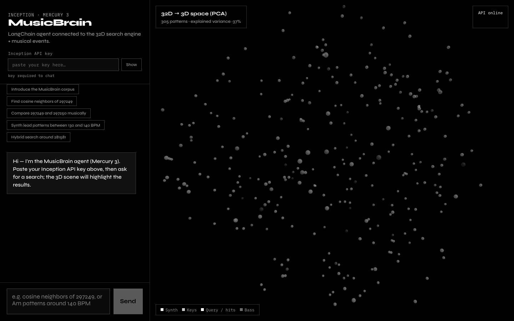
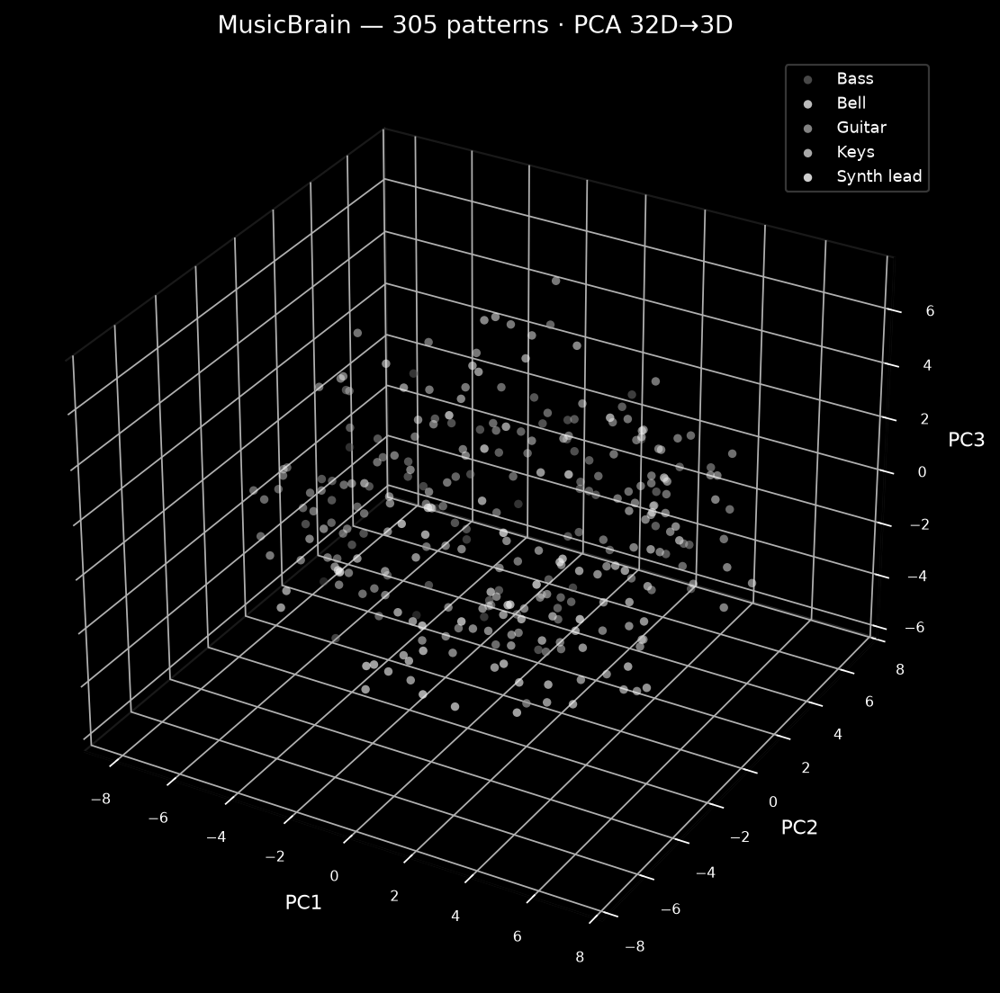

# MusicBrain

**Vector search engine for musical patterns** — with a Mercury 3 (Inception) LangChain agent, piano playback, and a black & white 3D UI.

MusicBrain turns symbolic music patterns into **32-dimensional feature vectors**, then lets you search them with classical vector metrics, sequence algorithms, and an LLM agent that calls those tools from natural language.





---

## What it does

1. **Ingest** ABC / NotaGen patterns into structured musical events (rests, chords, MIDI pitches).
2. **Encode** each pattern as an event matrix, then as a **32D embedding** (rhythm, melody, harmony, polyphony).
3. **Normalize** (Z-score + L2) so patterns live in a shared comparable space.
4. **Search** with vector, musical, and hybrid methods (no deep learning required).
5. **Explore** via a React UI: chat with Mercury 3, visualize the corpus in 3D (PCA), listen on a piano sampler.

Corpus size: **305 patterns** across Synth lead, Keys, Guitar, Bass, Bell.

---

## Interface walkthrough

| Area | Role |
|------|------|
| **Left panel** | Paste your Inception API key, chat with the agent, use suggested prompts |
| **Hits list** | Ranked results with **▶ piano** playback per pattern |
| **Right stage** | Full corpus in 3D (PCA of the 32D vectors); query / hits light up in white |

Example prompts:

- `Find cosine neighbors of 297249`
- `Compare 297249 and 297250 musically`
- `Synth lead patterns between 130 and 140 BPM`
- `Hybrid search around 281581`

---

## Architecture

```
ABC / PDF patterns
        │
        ▼
musical events JSON  ──► event matrices (type, onset, dur, pitch_min/max)
        │
        ▼
32D feature vectors  ──► Z-score + L2 normalisation
        │
        ├─► NumPy / scikit-learn search engine
        │
        ├─► FastAPI  (/api/chat, /api/corpus/3d, /api/patterns/.../playback)
        │
        └─► React UI + Tone.js piano + R3F 3D scene
                 ▲
                 │
         LangChain ReAct agent (Mercury 3 @ Inception)
```

### 32D feature layout

| Block | Dims | Content |
|-------|------|---------|
| Rhythm | D1–D8 | event count, attacks/bar, durations, silence, IOI stats |
| Melody | D9–D16 | pitch mean/min/max/range, intervals, ascending/descending ratios |
| Harmony | D17–D28 | 12 pitch-class histogram |
| Polyphony | D29–D32 | mean/max polyphony, poly ratio, mean chord size |

### Search methods

**Vector (32D):** cosine, dot, Euclidean, Manhattan, Minkowski, Chebyshev, Mahalanobis, radius, KNN  

**Musical (events):** DTW, edit distance, LCS, n-grams, subsequence, Jaccard  

**Hybrid:** weighted fusion, multi-vector (rhythm/melody/harmony/polyphony), RRF, metadata filters, threshold, exact match  

Ambiguous `pattern_id`s (same id on several instruments) auto-resolve preferring **Synth lead**.

---

## Quick start

```bash
git clone https://github.com/CharlesHenrynoah/VectorSearch.git
cd VectorSearch

python3 -m venv .venv
source .venv/bin/activate
pip install -r requirements.txt

# optional: rebuild embeddings from PDF / events
# python abc_to_musical_events.py
# python events_to_matrix.py
# python matrix_to_vector32.py
# python normalize_vectors32.py

cp .env.example .env   # or paste the key in the UI

# terminal 1 — API
export PYTHONPATH=.
./scripts/run_api.sh

# terminal 2 — UI
./scripts/run_ui.sh
```

- UI: http://127.0.0.1:5173  
- API docs: http://127.0.0.1:8000/docs  

Paste your **Inception API key** in the UI (stored in `localStorage` only).

---

## Project layout

```
musicbrain/
  api/                 FastAPI + Mercury 3 agent + tools
  search_engine/       vector / musical / hybrid search
  ui/                  React + Three.js + Tone.js
  data/normalized_vectors/
data/
  musical_events/      event JSON per pattern
  event_matrices/      5-column matrices
  normalized/          original / zscore / L2 vectors
docs/images/           UI & PCA screenshots
```

---

## Technical notes

- **Time unit** in events/matrices: `L:1/8` (eighth notes); a 4/4 bar = 8 units.
- **Normalisation:** column Z-score on 305×32, then row L2 → unit vectors (cosine ≡ dot product).
- **3D view:** PCA to 3 components for exploration only (not used as the search space).
- **Playback:** `/api/patterns/{id}/playback` flattens MIDI notes to seconds using pattern BPM; UI plays them with a Salamander piano sampler (Tone.js).
- **Agent tools:** `vector_search`, `musical_search`, `hybrid_pattern_search`, `compare_two_patterns`, `filter_patterns`, `get_pattern_info`, `corpus_overview`, `exact_match_search`.

---

## License

Project code © CharlesHenrynoah — see repository settings for license details.
